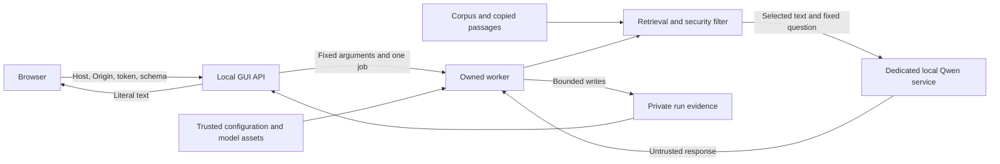

> v2.9 addendum (10 November 2026): TrustRAG adds fixed-context fresh filtering/answering, verified legacy support libraries, an explicit 12-case/three-condition allowlist and text/token budgets. Project records and report PDF are fixed read-only routes. Legacy NLTK advisory matches remain open; see SECURITY_REVIEW.md. The dated mapping below is retained with this scope extension; no full-compliance claim is made.

Updated 10 November 2026: v2.8 adds private configuration enforcement, same-byte retrieval loading, bounded HTTP security-event logs and an exclusive offline archive workflow. The dated model below remains the baseline; current details and residual limits are in SECURITY_REVIEW.md and REVIEW_DISPOSITION.md.

# Current GUI threat model and controls

9 November 2026 · Scope is local single-user operation with fixed research cases.

## What needs protection

The assets are sufficient answer evidence, trustworthy experiment identities, preserved answers and reviews, local files, and bounded CPU/disk/time use. The research attacker can insert controlled source copies. The application attacker can send malformed browser requests and place hostile-looking text in passages or answers. The model's response is also untrusted input to the application.

The OS account, local configuration, interpreter, approved model assets and release source are trusted. A hostile process using that account can bypass file and local-service protections. Corpus contents are semantically untrusted even when their file hashes match the expected experiment.

## Data flow and boundaries

The API and Qwen service use separate ports. The browser token protects mutations through the GUI API. Direct access by another local process to the separate model service remains within the trusted-host assumption.

## STRIDE assessment

| Threat | Example in this GUI | Implemented control and code | Fresh evidence | Residual limit |
|---|---|---|---|---|
| Spoofing | Another website tries to start a run | `server.Handler.guard`, loopback `Server`, random token | Host/origin/token tests, duplicate-header and same-site rejection | Trusted local processes can obtain the token; no user login |
| Tampering | Request changes a model/path, release file or run identity | `safety.check_selection`, `verify_release`, `study.load_study`, validated cancellation ID | Invalid fields, catalog escape, file tampering and null-cancel regression | Hashes need trusted distribution and trusted local files |
| Repudiation | A failed run is reported as completed or its source is disputed | `Manager.work/snapshot`, backend events, raw response capture and fingerprints | Failure, timeout, cancellation, partial export and identity suites | Local logs have no independent signature/time authority |
| Information disclosure | URL asks for a local configuration file or a hostile passage executes browser code | Fixed routes, private storage, `textContent`, CSP, sanitized errors | Route traversal, link refusal, real-browser hostile-text check | Exports intentionally contain evidence; user controls onward sharing |
| Denial of service | Many jobs, very large responses or a stuck worker | One active job, eight HTTP slots, byte/time/token/disk bounds and owned-process cleanup | Admission, body/header caps, worker-slot overflow, lifecycle checks | No hard OS memory quota or atomic disk quota |
| Elevation of privilege | Passage text becomes a shell command or model output invokes a tool | Fixed argument lists, no shell, no model-action executor, verified imports | Request-field rejection, static scan dispositions and prompt-role test | Dependency/native-code compromise remains possible |

The research's loss of answer support is a separate availability failure at the answer level. CPU/time limits address resource pressure. The evaluation measures whether the filter discards sufficient support.

## Implemented secure-development practices

| Practice | Project evidence |
|---|---|
| Security requirements and threat modeling | Task 4 model and present boundary/control table |
| Least privilege and restricted inputs | Trusted local account, private output, fixed inputs/routes/commands |
| Fail-closed validation | Invalid selections and malformed/truncated backend output stop the relevant operation |
| Dependency management | Pinned profile, inventory, fresh advisory query, separate candidate experiment |
| Traceable evidence | Request fingerprints, model/input identities, raw replies, preserved review records |
| Regression verification | Normal and optimized Python, boundary probes, JavaScript suites, actual browser |
| Controlled release | New version with manifests, ZIP checksums and original-source preservation |
| Explicit residual-risk handling | Open-risk table rather than treating a category mapping as closure |

## API inventory checked

| Method | Path | Purpose |
|---|---|---|
| GET / HEAD | `/`, `/app.js`, `/study.js`, `/style.css` | Fixed UI assets |
| GET / HEAD | `/api/bootstrap` | Catalog, active job and per-launch request token |
| GET / HEAD | `/api/reference/<case_id>` | Recorded primary evidence |
| GET / HEAD | `/api/study/<case_id>` | Nine-condition saved evidence through the sealed catalog |
| GET / HEAD | `/api/runs/<run_id>` | Current/partial recorded run state |
| POST | `/api/runs` | Fixed case/mode/condition selection |
| POST | `/api/cancel` | Cancel the matching active run with a valid ID |

Other routes are rejected. PUT, PATCH, DELETE, OPTIONS, TRACE and CONNECT are refused. The separate local model API is a different trust boundary. It is outside the GUI token protection.

## Limits checked in code

Eight HTTP worker slots, a 1,024-byte POST body, 8,192 parsed header-name/value characters, a 512-character route bound and a three-second socket timeout. Jobs have a 2,400-second limit, a 590-second answer-request timeout, at most four generation attempts and 128 generated tokens per answer. The model-response read is capped at 2 MiB. Admission checks cover 60 archived runs, a 1 GiB archive and 1 GiB free disk. A running job is stopped at 128 MiB recorded output or below 256 MiB free disk.

Some thresholds are tested with smaller synthetic fixtures. Polling limits can briefly overshoot, and parsed-header limits operate after the standard HTTP parser's own checks. These are application bounds rather than OS-enforced quotas.

## Framework references

STRIDE names follow [Microsoft's threat-modeling guidance](https://learn.microsoft.com/en-us/azure/security/develop/threat-modeling-tool-threats). OWASP editions and exact category treatment are recorded in `OWASP_COVERAGE.md`.
