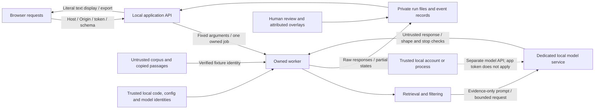

# Task 4 — trust boundaries and threat model

31 October 2026. Scope: local, single-user coursework demonstration plus separately bounded research runners. This is a model of the supplied system, not a public-service deployment approval.

The graph shows logical boundaries. Browser and model ports differ; a loopback address is a location constraint, not an identity for every local process. Task 3's command-line worker bypasses the browser API and has its own controls/profile. It does not acquire all GUI quotas merely by using the same model port.

## Assets and actors

| Asset | Why it matters | Principal threat |
|---|---|---|
| Sufficient answer support and usable answers | Core research objective | Valid correct-copy input can cause support loss; wrong claims can survive |
| Frozen methods, encoder/model identities and request settings | Comparable results | Replacement, drift, malicious approved artifact or mistaken configuration |
| Raw replies, run states, review attribution and accepted overlays | Reconstructable science | Fabricated completion, silent retry, mutable provenance or overclaimed review |
| CPU, memory, disk and service availability | Finish a bounded demonstration | Excess jobs, slow responses, large output or incomplete cleanup |
| Local files, passages, review details and paths | Intended evidence access | Unintended disclosure or unrestricted export |

The main research adversary can insert one or two copies of an accessible source for a known target question. Original records, the question, embeddings/settings and compared defenses are held fixed. Corpus insertion is simulated; ingestion compromise is not demonstrated. Background-source copies are controls. Adding a false claim or an instruction is a separate challenge. Evaluator-only correct-source labels must not become a defense shortcut.

An application adversary may send malformed or cross-origin browser requests, supply dangerous-looking corpus/model text, consume resources, or manipulate local artifacts if a trust assumption fails. The system assumes a trusted operating-system account, configuration, interpreter, pinned inputs and installed model assets. Compromise of that account or dependency can defeat local checks; hashes do not eliminate this scenario.

## Boundary-to-control trace

| Boundary | Data or authority crossing | Controls | Remaining limit |
|---|---|---|---|
| Browser → local app | Select case/mode/condition, read saved runs, request cancellation | CTRL01, CTRL02, CTRL04, CTRL06 | No user roles/authenticated reviewers; trusted local process can obtain/use token |
| App → worker and files | Fixed command, output folder and settings | CTRL03, CTRL04, CTRL05, CTRL08 | Trusted local code/config/account; no general OS sandbox |
| Corpus → retrieval/filter/model | Untrusted text and input composition | CTRL03, CTRL10, CTRL11 | Valid inputs still cause observed support loss; no general mitigation |
| Worker → separate model API | Fixed loopback calls and frozen generation | CTRL03, CTRL05, CTRL06, CTRL11, CTRL12 | App nonce does not protect direct API access or audit all service-management routes |
| Model/file → GUI/export/reviewer | Untrusted text and partial raw output | CTRL04, CTRL05, CTRL09, CTRL10, CTRL11 | Intended exports expose full evidence; no external authenticity/privacy guarantee |
| Dependencies/checkpoints → execution | Executable/native code and learned parameters | CTRL03, CTRL12 | Open advisories, origin/backdoor uncertainty and check-to-use limitations |

STRIDE denial of service is recorded in two senses: operational resource exhaustion and the research loss of a supported answer. A request quota controls the former; it does not repair the latter. Similarly, an unchanged raw answer may be wrong, and a correct answer may be unsupported by supplied evidence. Byte integrity, semantic correctness and scientific review are separate checks.

No public hosting, multi-user roles, confidential training cohort, training/fine-tuning/feedback updates, private model-IP objective, uploads, SQL sink or model-controlled tool/action executor is included. The [mapping](RISK_MAPPING.md) records the relevant exclusions and triggers for reassessment rather than marking those categories passed.
